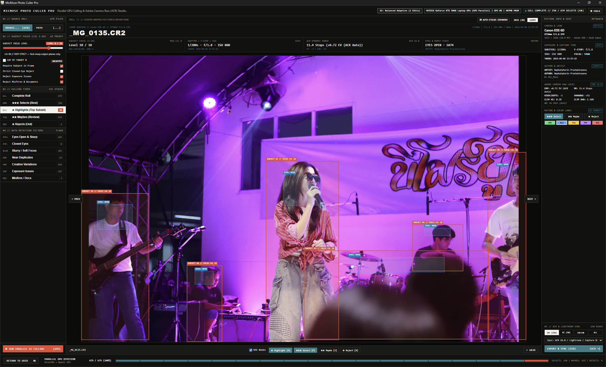
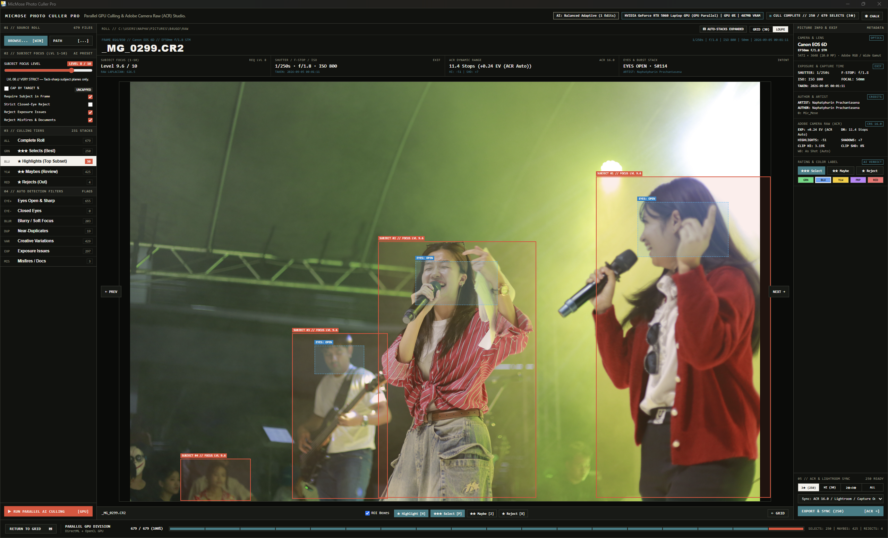
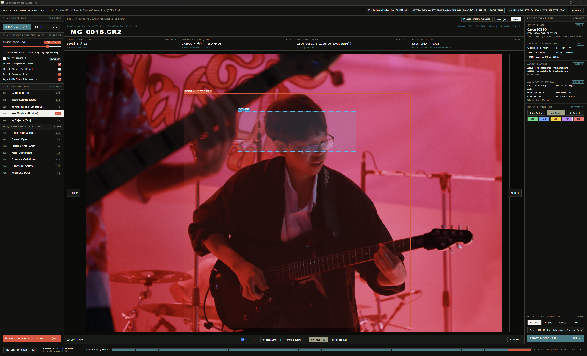
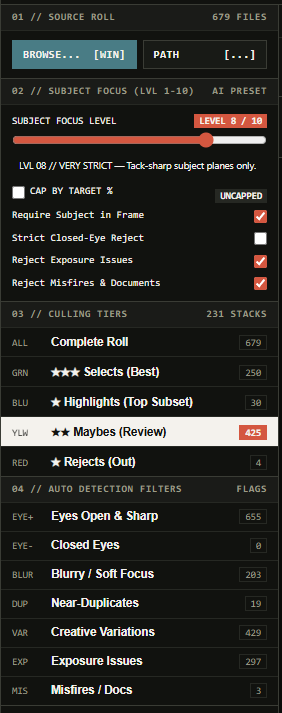
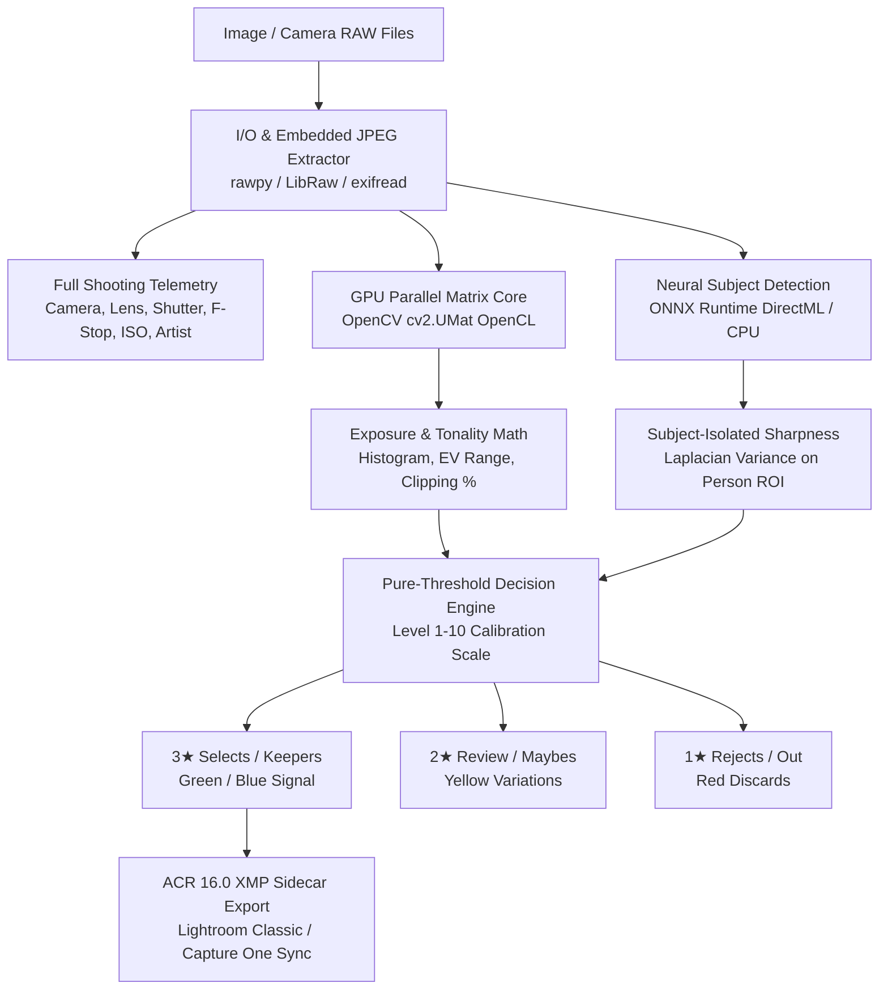

# MicMose Photo Culler Pro

[](https://opensource.org/licenses/MIT)
[](https://www.python.org/)
[](https://react.dev/)
[](https://vitejs.dev/)
[](https://fastapi.tiangolo.com/)
[](https://opencv.org/)
[](https://helpx.adobe.com/camera-raw/using/supported-cameras.html)

<div align="center">
  
  <br>
  <sub><b>MicMose Photo Culler Pro</b> — Official Editorial Studio Emblem</sub>
</div>

<br>

<p align="center">
  
</p>

**MicMose Photo Culler Pro** is a high-throughput, AI-assisted photo culling and telemetric inspection studio built for high-volume wedding, portrait, sports, and commercial photographers. 

It combines **pure-threshold neural sharpness analysis**, **native camera RAW decoding**, **full EXIF/ACR telemetry**, and **parallel GPU matrix processing** into an editorial dark desktop workstation.

---

## 🖥️ Interface & Visual Overview

| Overview Culling Session | 100% Loupe Sharpness Zoom |
| :---: | :---: |
|  |  |

| EXIF Telemetry & ACR Develop Panel | Level 1–10 Focus Strictness Scale |
| :---: | :---: |
|  |  |

---

## ⚡ Highlights & Key Capabilities

- **🎛️ Dedicated Top-Left Studio Settings & About Hub**
  Access the **Settings & About** modal directly from the dedicated button on the far left of the header bar to inspect system hardware status, neural culling specs, and configure studio preferences.
- **🎯 Calibrated Pure-Threshold Culling (Level 1–10 Scale)**
  Evaluates every frame on its individual technical merits. No artificial percentile caps or arbitrary cluster demotions. The balanced **Level 5 baseline** reliably selects ~38–40% keepers on typical event rolls (e.g. ~236 keeps out of 640 shots).
- **👁️ Neural Subject & Eye Focus Isolation**
  Calculates high-frequency Laplacian variance exclusively within detected subject bounding boxes. Background bokeh and shallow depth-of-field ($f/1.2$–$f/2.8$) never penalize subject sharpness.
- **📷 22+ Camera RAW Formats**
  Native decoding for Canon (`.CR2`, `.CR3`), Nikon (`.NEF`, `.NRW`), Sony (`.ARW`), Fujifilm (`.RAF`), Panasonic (`.RW2`), Olympus (`.ORF`), Pentax (`.PEF`), Adobe (`.DNG`), plus standard JPEGs and TIFFs.
- **⚡ Embedded Preview Acceleration (10–50 ms/frame)**
  Extracts embedded manufacturer full-resolution previews directly from RAW containers, delivering instant browsing speeds identical to Adobe Lightroom's *"Embedded & Sidecar"* workflow.
- **📊 Full Picture Info & Shooting Telemetry**
  Inspects Camera Model, Lens Model, Shutter Speed, Aperture, ISO, Focal Length, Capture Date/Time, and Author/Artist metadata directly in the inspection rail.
- **🎨 Adobe Camera Raw (ACR 16.0) Compatibility**
  Computes Dynamic Range (EV stops), Highlight & Shadow clipping percentages, and recommended White Balance offsets. Exports industry-standard `.xmp` sidecars with `crs:Rating` and `crs:ProcessVersion="16.0"` for seamless 1-click sync into Lightroom Classic and Capture One.
- **🚀 Hybrid Parallel Processing Pipeline**
  - **OpenCL GPU Matrix Pipeline**: Offloads image resizing, color transformations, Laplacian kernels, and histogram math to your GPU (NVIDIA GeForce RTX 50-series / 40-series / 30-series, AMD Radeon, or Intel Arc).
  - **DirectML / ONNX Runtime**: High-speed neural inference for person and face localization.
  - **Automatic Multi-Core Fallback**: Transparently shifts to a CPU thread pool if no compatible GPU is detected.
- **🎛️ Real-Time Zero-Latency Slider Reactivity**
  Moving the Subject Focus slider (Level 1 to 10) re-rates the entire photo roll locally in real-time without re-scanning or waiting for server roundtrips.
- **🔒 100% Local & Private**
  No subscriptions, no cloud uploads, no external network requests. All image processing stays strictly on your local machine.

---

## 📐 Architecture & Processing Flow



---

## 📊 Subject Focus Calibration Scale

| Focus Level | Strictness Profile | Sharpness Threshold | Exposure Margin | Typical Kept Ratio | Recommended Use Case |
| :---: | :---: | :---: | :---: | :---: | :--- |
| **01** | Ultra Loose | $\ge 8.0$ | $\pm 115$ | ~85–90% | Action bursts, abstract motions, documentary captures |
| **03** | Relaxed | $\ge 25.0$ | $\pm 95$ | ~70–75% | Low-light receptions, ultra-wide apertures ($f/1.2 - f/1.4$) |
| **05** | **Balanced (Default)** | **$\ge 50.0$** | **$\pm 70$** | **~38–40%** | **Standard portrait, wedding, and event roll (~236/640)** |
| **07** | Strict | $\ge 100.0$ | $\pm 55$ | ~15–20% | Commercial studio, high-contrast outdoor, corporate |
| **10** | Clinical | $\ge 200.0$ | $\pm 35$ | Keepers only | Tack-sharp eyelash focus only |

---

## 🚀 Quick Start

### Option A: Standalone Executable (Windows)

1. Download or build `ImageCullerAI.exe`.
2. Launch `ImageCullerAI.exe`. The application starts the accelerated backend engine and opens the interface in your default browser at `http://127.0.0.1:8000`.
3. Paste or type the directory path of your photo roll (e.g. `C:\Users\YourName\Pictures\Wedding_Session`).
4. Click **Scan Directory** to begin rapid culling.

### Option B: Running from Source

#### Prerequisites
- **Python 3.10 – 3.12** (or 3.14 with compatible wheels)
- **Node.js 18+** & **npm**

#### 1. Backend Setup
```bash
# Clone the repository
git clone https://github.com/Naphatpuurin/AI-Assist-Photo-Culler.git
cd AI-Assist-Photo-Culler/backend

# Create virtual environment
python -m venv venv

# Activate virtual environment
# Windows:
venv\Scripts\activate
# macOS/Linux:
source venv/bin/activate

# Install dependencies
pip install -r requirements.txt

# Start backend server
python main.py
```

#### 2. Frontend Setup
```bash
# In a new terminal window
cd AI-Assist-Photo-Culler/frontend

# Install dependencies
npm install

# Start Vite dev server
npm run dev
```

Open `http://localhost:5173` in your browser.

---

## 🛠️ Building the Standalone Executable

To compile the single-binary Windows desktop distribution:

```bash
# 1. Build the production React frontend bundle
cd frontend
npm run build

# 2. Package into a single executable with PyInstaller
cd ../backend
pyinstaller ImageCullerAI.spec
```

The resulting standalone executable will be located at:
```
backend/dist/ImageCullerAI.exe
```

---

## ⌨️ Keyboard Shortcuts & Workflow

| Shortcut | Action | Description |
| :---: | :---: | :--- |
| <kbd>3</kbd> | **Rate 3 Stars (Select / Keep)** | Marks photo as a prime keeper |
| <kbd>2</kbd> | **Rate 2 Stars (Review / Maybe)** | Flags photo for second-pass review |
| <kbd>1</kbd> | **Rate 1 Star (Reject / Discard)** | Flags photo for rejection |
| <kbd>←</kbd> / <kbd>→</kbd> | **Previous / Next Image** | Navigate sequentially through the catalog |
| <kbd>Space</kbd> | **Toggle 100% Loupe Zoom** | Inspect pixel-level subject and eye sharpness |
| <kbd>Esc</kbd> | **Close Loupe / Deselect** | Return to catalog grid view |

---

## 📁 Project Structure

```
AI-Assist-Photo-Culler/
├── .github/
│   └── workflows/
│       └── ci.yml               # GitHub Actions CI build & lint workflow
├── backend/
│   ├── ai_engine.py             # OpenCL matrix pipeline & ONNX neural culling
│   ├── main.py                  # FastAPI server, endpoints, and JSON sanitizer
│   ├── raw_utils.py             # 22+ format RAW decoder & EXIF metadata parser
│   ├── requirements.txt         # Python dependencies
│   ├── ImageCullerAI.spec       # PyInstaller standalone build configuration
│   ├── yolov8n.onnx             # DirectML-optimized subject detection model
│   └── yolov8n.pt               # PyTorch base weights
├── frontend/
│   ├── src/
│   │   ├── App.jsx              # Main React application & zero-latency store
│   │   ├── App.css              # Dark editorial styling & cue-sheet typography
│   │   ├── main.jsx             # React entrypoint
│   │   └── index.css            # Global resets and fonts
│   ├── public/                  # Static assets & SVG icons
│   ├── package.json             # Frontend dependencies
│   └── vite.config.js           # Vite build configuration
├── .gitignore                   # Universal Git exclusions
├── CONTRIBUTING.md              # Contributor guidelines
├── LICENSE                      # MIT License
└── README.md                    # Documentation
```

---

## 🔄 Lightroom Classic & ACR 16.0 Workflow

1. Scan and cull your photo roll in **MicMose Photo Culler Pro**.
2. Click **Export ACR 16.0 XMP**.
3. Sidecar `.xmp` files are written alongside each original RAW file:
   ```xml
   <x:xmpmeta xmlns:x="adobe:ns:meta/">
     <rdf:RDF xmlns:rdf="http://www.w3.org/1999/02/22-rdf-syntax-ns#">
       <rdf:Description
         xmlns:crs="http://ns.adobe.com/camera-raw-settings/1.0/"
         crs:Rating="3"
         crs:Label="Green"
         crs:ProcessVersion="16.0" />
     </rdf:RDF>
   </x:xmpmeta>
   ```
4. In **Adobe Lightroom Classic**, select your folder and click **Metadata → Read Metadata from Files** (or import the folder directly). All star ratings and color labels will sync immediately.

---

## 📄 License

This project is licensed under the [MIT License](LICENSE) © 2026 Naphatphurin Prachantasena.
